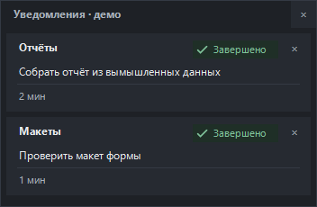
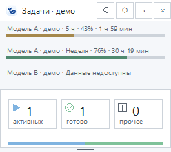

# Виджет задач DeepSeek Harness для Windows

Плагин показывает, какие задачи выполняются в рабочих областях Harness и с каким результатом они завершились. Уведомления остаются в отдельном окне, пока вы их не закроете.

- В обычном виде карточка показывает состояние, задачу и выбранные в настройках детали. В компактном виде видны счётчики и краткий список рабочих областей.
- Щёлкните по карточке задачи или по тексту уведомления, чтобы открыть связанный чат в текущем окне Harness. Крестик на уведомлении закрывает его.
- В настройках на вкладке «Состояния» включите «Без задач», если хотите видеть пустые рабочие области.
- Потяните за нижнюю кромку, чтобы изменить высоту виджета. Перетащите окно уведомлений за заголовок. Виджет запоминает положение обоих окон.
- В заголовке есть переключатель светлой и тёмной темы. Здесь же можно открыть настройки полей, состояний и уведомлений субагентов.
- Если включить «Лимиты ИИ», над задачами появятся тонкие полосы с остатком и временем до сброса. Цвет меняется в зависимости от остатка.
- Синий значок с китом и галочкой используется в заголовке, на панели задач и рядом с часами. Через значок рядом с часами можно снова открыть скрытое окно.

## Как выглядит

На снимках только вымышленные рабочие области, задачи и значения лимитов.

| Тёмная тема | Светлая тема |
| --- | --- |
|  |  |
|  |  |

Компактный вид и настройки

## Лимиты ИИ

Для Codex показатели запрашиваются через Codex Connect в авторизованном окне Harness. Когда источник не передаёт показатели, виджет показывает «Данные недоступны». По каждому окну лимита виджет получает процент остатка, длительность окна и время сброса, если сервис его сообщил.

## Проверка и демонстрация

Понадобятся Windows с .NET Framework, Node.js и npm. Для демонстрации Harness необязателен.

~~~powershell
npm test
npm run preview -- --demo
~~~

Демонстрация использует вымышленные рабочие области. Нажмите q или Ctrl+C, чтобы закрыть её. Для отдельной папки состояния передайте --data-dir и путь.

## Подключение к Harness

Соберите помощник командой npm run build. При подключении пакета к профилю Harness используйте dsh.bundle.patch и cordis.patch.yml. Сборка и демонстрация сами профиль не меняют.

Плагин сохраняет настройки окон и краткую историю результатов локально.
