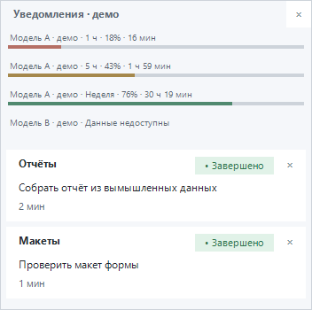
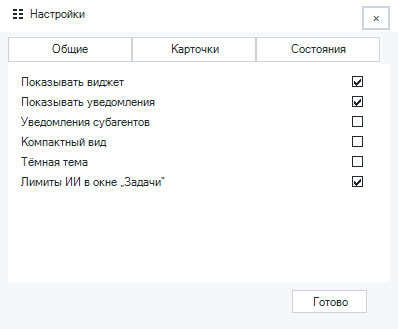
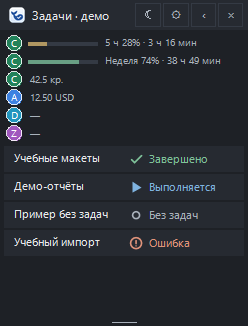
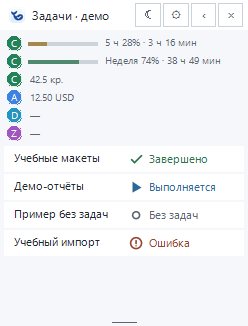
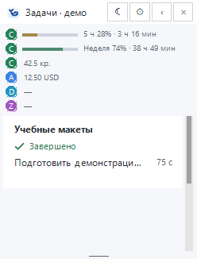
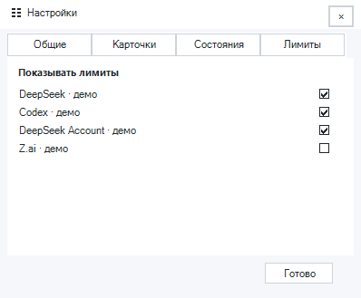
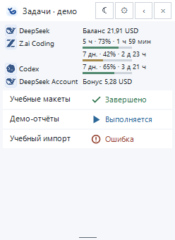
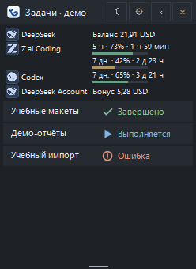

# Виджет задач DeepSeek Harness для Windows

Плагин показывает, какие задачи выполняются в рабочих областях Harness и с каким результатом они завершились. Уведомления остаются в отдельном окне, пока вы их не закроете.

- В подробном режиме карточки показывают задачу и выбранные поля. В разделе «Общие» можно включить короткий список с названием рабочей области и статусом в одной строке. Стрелка в заголовке переключает список и сводку со счётчиками.
- В разделе «Карточки» включите «Время рядом с задачей», чтобы видеть длительность справа от текста задачи. Настройка «Время» управляет нижней строкой карточки.
- Щёлкните по карточке задачи или по тексту уведомления, чтобы открыть связанный чат в текущем окне Harness. Крестик на уведомлении закрывает его.
- В настройках на вкладке «Состояния» включите «Без задач», если хотите видеть пустые рабочие области.
- Потяните за нижнюю кромку, чтобы изменить высоту виджета. Перетащите окно уведомлений за заголовок. Виджет запоминает положение обоих окон.
- В заголовке есть переключатель светлой и тёмной темы. Здесь же можно открыть настройки полей, состояний и уведомлений субагентов.
- На вкладке «Лимиты» можно включить панель и выбрать службы, которые видны над задачами. Слева видны название и логотип службы на одинаковой округлой подложке. Справа отображаются процент и время до сброса, кредиты или баланс. Для длинных сумм виджет показывает до двух знаков после запятой, а в подсказке сохраняет исходное значение.
- Синий значок с китом и галочкой используется в заголовке, на панели задач и рядом с часами. Через значок рядом с часами можно снова открыть скрытое окно.

## Как выглядит

На снимках только вымышленные рабочие области, задачи и значения лимитов.

| Тёмная тема | Светлая тема |
| --- | --- |
|  |  |
|  |  |

Компактный вид и настройки

| Компактный список, тёмная тема | Компактный список, светлая тема |
| --- | --- |
|  |  |

| Длительность рядом с задачей | Выбор служб |
| --- | --- |
|  |  |

[Длительность в тёмной теме](docs/screenshots/tasks-duration-dark.png) · [Выбор служб в тёмной теме](docs/screenshots/settings-providers-dark.png)

## Лимиты ИИ

Для Codex виджет использует подключение Codex Connect. Если подключение передаёт кредиты или доступный остаток по индивидуальному ограничению расходов, они появляются отдельной строкой. DeepSeek Account может показать баланс кошелька в валюте через подключённый аккаунт. Отдельная строка DeepSeek показывает доступный баланс API-аккаунта в USD или CNY. Z.ai Coding показывает остаток по тем окнам Coding Plan, которые вернул глобальный сервис Z.ai, и время сброса, когда оно известно.

Виджет использует настройки и ключи соответствующих подключений из хранилища Harness. Запросы выполняет сам Harness на официальные серверы. При отсутствии данных источник подписывается «Нет данных».

| Демонстрационные остатки, светлая тема | Демонстрационные остатки, тёмная тема |
| --- | --- |
|  |  |

[Источник логотипов служб](assets/providers/SOURCES.md)

## Проверка и демонстрация

Понадобятся Windows с .NET Framework, Node.js и npm. Для демонстрации Harness необязателен.

~~~powershell
npm test
npm run preview -- --demo
~~~

Демонстрация использует вымышленные рабочие области. Нажмите q или Ctrl+C, чтобы закрыть её. Для отдельной папки состояния передайте --data-dir и путь.

## Звук уведомлений

В разделе «Общие» включите «Звук уведомлений». Кнопка «Прослушать звук» работает и при выключённой настройке. Виджет подаёт сигнал при появлении нового уведомления, которое разрешают текущие фильтры состояний.

Для классического сигнала ICQ сохраните WAV как icq-message.wav в папке настроек виджета. По умолчанию это %USERPROFILE%/.dsh/workspace-notifications. Если выбран отдельный каталог данных, используйте его. Пока подходящего файла в этой папке нет, звучит системный сигнал Windows. [Архив звуков ICQ](https://www.webafterlife.net/grave/icq-sounds)

[Настройка в светлой теме](docs/screenshots/settings-sound-light.png) · [Настройка в тёмной теме](docs/screenshots/settings-sound-dark.png)

## Подключение к Harness

Соберите помощник командой npm run build. При подключении пакета к профилю Harness используйте dsh.bundle.patch и cordis.patch.yml. Сборка и демонстрация сами профиль не меняют.

Плагин сохраняет настройки окон и краткую историю результатов локально.
