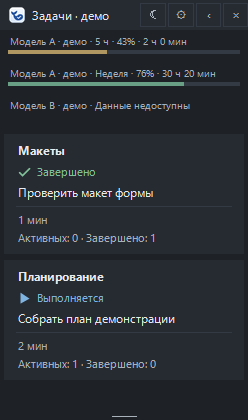
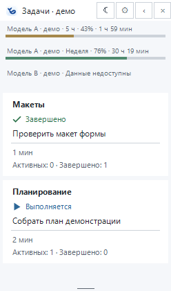

# Виджет задач DeepSeek Harness для Windows

Плагин показывает состояние рабочих областей Harness в отдельном окне и оставляет уведомления о завершении задач до закрытия. Виджет помогает увидеть, где ещё идёт работа и какие задачи уже завершились.

- Обычный и компактный виды виджета.
- Настройка полей, состояний и уведомлений субагентов.
- Прокрутка целыми карточками и восстановление положения окон.
- Доступ к настройкам через значок рядом с часами.

- Светлая и тёмная темы с переключением в заголовке.
- Тонкие полосы лимитов над карточками уведомлений. Цвет зависит от остатка, рядом есть процент и время до сброса.

## Предпросмотр нового оформления

На снимках только вымышленные задачи. Остатки лимитов и время до сброса тоже демонстрационные.

### Тёмная тема

| Виджет «Задачи» | Уведомления и лимиты ИИ |
| --- | --- |
|  |  |

### Светлая тема

| Виджет «Задачи» | Уведомления и лимиты ИИ |
| --- | --- |
|  |  |

<details>
<summary>Окно настроек</summary>


</details>

## Проверка и демонстрация

Понадобятся Windows с .NET Framework, Node.js и npm. Harness для демонстрации необязателен.

```powershell
npm test
npm run preview -- --demo
```

Демонстрация использует вымышленные рабочие области. Нажмите `q` или `Ctrl+C`, чтобы закрыть её. Для отдельной папки состояния добавьте `--data-dir` и путь.

## Лимиты ИИ

В настройках можно включить «Лимиты ИИ». Для Codex показатели поступают через Codex Connect в авторизованном окне Harness. У других подключённых служб, которые не передают такие показатели, отображается «Данные недоступны».

Виджет получает только процент остатка, длительность окна и время сброса, если сервис его сообщил. Числа на снимках выше вымышлены.

## Подключение к Harness

Соберите помощник командой `npm run build`. Используйте `dsh.bundle.patch` и `cordis.patch.yml` при подключении пакета к профилю Harness. Сборка и демонстрация сами профиль не меняют.

Плагин сохраняет настройки окон и краткую историю результатов локально. В репозитории находятся исходники, инструкции и тесты.
